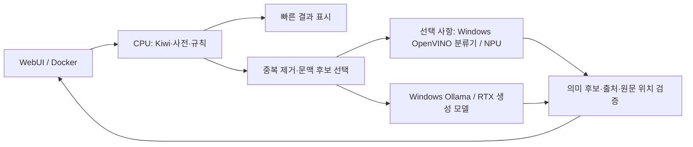

# 모델 실행 가능성·NPU·프로젝트 성능 분석

진단일: 2026-10-29 (Asia/Seoul). **현재 연결된 RTX 3090을 사용할 수 있는 경우와 노트북 내장 장치만 사용하는 경우를 구분합니다.**

## 1. 원인 및 확인한 환경

현재 분석기는 Docker에서 CPU로 Kiwi·사전·문맥 규칙을 실행하고, 문맥 생성은 Windows 호스트의 Ollama에 HTTP로 요청합니다. Docker 웹 서비스의 2 CPU·2GiB 제한은 호스트 Ollama의 GPU 추론 메모리 한도가 아닙니다.

| 항목 | 실제 조회 결과 |
| --- | --- |
| 노트북 | Samsung 960XHA |
| CPU | Intel Core Ultra 7 258V, 8코어·8스레드 |
| RAM | 사용 가능 물리 메모리 총량 약 31.5GiB. 진단 시작 여유 약 8.6GiB, 보조 모델 정리 후 약 8.5GiB |
| 내장 GPU | Intel Arc 140V. 장치명의 16GB는 시스템 메모리와 공유되는 영역이며 별도 전용 VRAM으로 합산하지 않음 |
| 별도 GPU | NVIDIA GeForce RTX 3090, 전용 VRAM 24,576MiB. nvidia-smi 및 실제 모델 GPU 배치 확인 |
| NPU | Intel AI Boost, 장치 상태 OK. 드라이버 32.0.100.4724 |
| OS | Windows 11 Home, 10.0.26200 |
| Ollama | 0.40.8 |
| 기존 호스트 Python | PyTorch 2.12.0+cpu, CUDA=False. ONNX Runtime 1.26.0 제공자는 Azure/CPU |
| 진단용 격리 환경 | Python 3.12.10, OpenVINO 2026.4.1, NumPy 2.5.4 |

258V의 NPU 정격은 [Intel 공식 사양](https://www.intel.com/content/www/us/en/products/sku/240957/intel-core-ultra-7-processor-258v-12m-cache-up-to-4-80-ghz/specifications.html) 기준 INT8 47 TOPS입니다. 이 수치는 언어모델의 초당 토큰 수가 아닙니다. RTX의 실제 연결 방식은 조사하지 않았으므로 내장 GPU라고 단정하지 않습니다. WMI AdapterRAM은 RTX에서 약 4GB로 잘못 표시돼 VRAM 판정에는 nvidia-smi 값을 사용했습니다.

**호스트 PyTorch가 CPU용이어도 Ollama는 별도 NVIDIA 추론 런타임으로 GPU를 사용합니다.** 이번 측정에서 각 모델의 `size_vram`이 모델 배치 크기와 동일했고 nvidia-smi에서도 점유를 확인했습니다. [Ollama 공식 지원 목록](https://docs.ollama.com/gpu)에도 RTX 3090이 포함돼 있습니다.

## 2. 네 모델의 실행 가능성과 연동 방안

아래 판정은 배포 메타데이터·모델 구조·실제 장치 확인을 조합한 **호환성 판단**입니다. 네 후보의 가중치를 모두 받아 실행한 결과는 아닙니다.

| 후보 | 현재 RTX 3090 환경 | RTX 없이 노트북만 사용할 때 | NPU 및 연동 판단 |
| --- | --- | --- | --- |
| [EXAONE-3.5-7.8B-Instruct-KoCulture](https://huggingface.co/huggingface-KREW/EXAONE-3.5-7.8B-Instruct-KoCulture) | 준비 후 실행 가능성이 높음. 7,818,448,896개 파라미터·BF16 safetensors. BF16 가중치만 약 14.56GiB여서 24GiB에 수용 가능하나 KV 캐시·실행 여유가 추가로 필요. 실용적으로 INT4 권장 | 32GB 총 RAM에는 INT4가 들어가지만 현재 여유 RAM이 8.5GiB 정도라 다른 프로그램과 경합 가능. BF16은 현재 여유 메모리로 권장하지 않음 | OpenVINO GenAI에 EXAONE 3.5 계열 지원이 있으나, 이 파생 체크포인트의 NPU 실행은 미검증. 변환·대칭 INT4·컨텍스트 설정을 검증해야 함. 현재 Ollama에 이름만 넣는 것으로는 사용할 수 없음 |
| [Qwen3-4B-Korean-Slang-2026-LoRA](https://huggingface.co/DevJeongDaeRi/Qwen3-4B-Korean-Slang-2026-LoRA) | 4B 본체는 충분히 수용 가능. 그러나 공개 파일은 `adapters.safetensors`와 MLX 설정으로, 현재 Windows/Ollama에 바로 읽히는 완성 모델이 아님 | 호환 형식으로 준비하면 CPU·Arc·NPU 검토 가능. 어댑터 파일만으로 추론 불가 | 정확한 Qwen3-4B-Instruct-2507 기반 모델과 MLX 어댑터를 결합하고 키·계층 매핑 또는 재학습을 검증한 뒤 변환해야 함. **현재 설치된 Qwen3.5:4b에 붙일 수 있다고 가정하면 안 됨** |
| [euphemism-detector-multilingual](https://huggingface.co/hasancanbiyik/euphemism-detector-multilingual) | XLM-RoBERTa-base 계열 12층·hidden 768의 이진 분류기. CPU·GPU 실행에 가장 작은 부담. 생성 모델보다 훨씬 작음 | CPU 실행부터 비교할 가치가 높음. 후보 구절을 지정해 literal/euphemistic 점수를 받음 | **NPU 첫 실험 후보**. 토크나이저는 CPU, 고정 길이 분류 그래프는 OpenVINO로 변환해 NPU 검증. 공개 버전은 PyTorch `.bin`이므로 변환 준비 필요. XLM-R 전체 그래프의 NPU 컴파일·정확도·속도는 미검증 |
| [SlangOWL / SlangDIT](https://arxiv.org/abs/2505.14181) | 논문의 7B·8B·14B 구조는 INT4라면 24GB에서 실행을 검토할 수 있음. 14B BF16 가중치만 약 26GiB로 전용 VRAM 초과 | 7B/8B INT4는 메모리상 가능성을 검토할 수 있지만 CPU 생성 지연이 커질 수 있음. 14B는 현재 여유 RAM에서 부적합 | [공식 저장소](https://github.com/XL2248/SlangDIT)에서 즉시 로드할 학습 가중치를 확인하지 못함. 현재는 실행 준비 불가로 판단. 영어→중국어 과제라 한국어 원형 복원에도 별도 검증 필요 |

INT4 이상적 가중치 하한은 4B 약 1.86GiB, 7.8B 약 3.64GiB, 14B 약 6.52GiB입니다. 이는 단순 `파라미터 수 × 0.5 byte` 계산이며 실제 파일·임베딩·양자화 메타데이터·KV 캐시·변환 중 메모리는 더 큽니다. 이 하한을 실제 점유량으로 보지 마세요. 여러 생성 모델을 동시에 상주시킬 이유는 현재 용도에서 크지 않습니다.

KoCulture 모델 카드는 비영리 사용 제한과 정성 평가 중심의 한계를 명시합니다. 한국어 성착취 초성 해석의 품질 우위를 입증하는 자료는 아닙니다. 분류기의 한국어 평가는 합성 예문 10개여서 한국어 실사용 정확도로 볼 수 없습니다. 본 작업에서는 성능 측정과 정확도 평가를 구분했습니다.

### 현재 코드에 연결할 구조



1. `app/contextual.py:225`의 ContextInterpreter에서 공급자 인터페이스를 분리합니다. `health`, `interpret` 및 별도 `classify`를 두고 기존 Ollama 구현을 기본으로 유지하는 방식이 적합합니다.
2. 현재 `info()`는 `/api/tags`, 생성은 `/api/chat`에 의존합니다. OpenVINO 서버 URL로 주소만 바꾸면 호환되지 않습니다. Ollama 호환 계층을 제공하거나 별도 OpenVINOBackend가 필요합니다. JSON 스키마에 대한 생성 제약도 런타임별로 검증합니다.
3. Windows NPU는 이번에 검증된 **Windows 네이티브 작업 프로세스**에서 사용하고, Docker 앱은 `host.docker.internal:<확인한 빈 포트>`로 호출하는 구성을 우선합니다. 현재 Compose에는 NPU 장치 전달 설정이 없으며 `gpus: all` 추가만으로 NPU가 연결되는 구조가 아닙니다. 호스트 경로·포트·접근 범위와 Docker에서의 실제 연결은 새 서비스 도입 때 확인해야 합니다.
4. KoCulture는 별도 CUDA 추론 환경 또는 검증한 변환 모델로 호스트에서 실행합니다. 기존 웹 컨테이너의 2GiB 안에 원본 모델을 넣지 않습니다. 원형·출처 검증과 미확인 처리는 기존 코드에 유지합니다.
5. 분류기는 `{literal/euphemistic, confidence}`를 반환하고, 원형 생성은 생성 모델이 담당합니다. 분류 점수를 성착취·불법성 확률이나 특정 원형의 정답 확률로 표시하지 않습니다.
6. MLX 어댑터 및 SlangOWL은 형식·가중치 준비가 선행돼야 하므로 모델 선택 목록에 이름만 추가하는 방식으로 구현하지 않습니다.

[OpenVINO 지원 아키텍처 목록](https://openvinotoolkit.github.io/openvino.genai/docs/supported-models/)은 EXAONE·Qwen3 계열을 포함하지만, 해당 표가 모든 파생 모델의 모든 장치에서의 검증을 의미하지는 않습니다. [NPU GenAI 문서](https://docs.openvino.ai/2026/openvino-workflow-generative/inference-with-genai/inference-with-genai-on-npu.html)는 대칭 INT4/NF4, 정적 프롬프트 길이 등 NPU 전용 설정을 설명합니다.

## 3. 추가 파일과 실제 측정

애플리케이션 소스·UI·Compose·프로덕션 의존성은 변경하지 않았습니다. 진단 스크립트·격리 환경·측정 JSON·보고서만 추가했습니다. 파일 목록은 `PERFORMANCE_FILES.txt`에 있습니다. 선택 설치용 `requirements-diagnostics.txt`는 프로덕션 requirements에 연결하지 않습니다.

### 실제 프로젝트 프롬프트 비교

동일한 합성 문장 세 개와 현재 ContextInterpreter·JSON 스키마를 사용했습니다. 문장 길이는 32~41자, 모델 후보는 3~8개, 요청 컨텍스트는 8,192, 생성 상한은 2,200토큰입니다. **아래 모델은 이미 설치된 모델이며 위에서 조사한 네 후보를 대신 실행한 결과가 아닙니다.**

| 실제 측정 모델 | 첫 문장(로딩 포함) | 이후 두 문장 | 생성 구간 속도 | Ollama 보고 GPU 배치 |
| --- | --- | --- | --- | --- |
| Qwen3.5:9b Q4_K_M | 15.27초 | 3.20 / 2.65초 | 78.3~83.1 tok/s | 약 5.46GiB |
| Qwen3.5:4b Q4_K_M | 10.97초 | 2.78 / 1.88초 | 84.5~120.8 tok/s | 약 3.13GiB |
| Qwen2.5:7b-instruct Q4_K_M | 14.76초 | 4.65 / 3.00초 | 94.0~95.7 tok/s | 약 4.80GiB |

첫 로딩 자체는 각각 약 11.39초·8.72초·7.43초였습니다. 모델별 생성 토큰 수가 달라 총 지연 순서와 tok/s 순서가 같지 않습니다. 첫 호출은 진단 시작 시 모델 비상주 상태 또는 모델별 첫 호출이며, OS 파일 캐시는 통제하지 않았습니다.

실제 운영 `/api/context/interpret`는 준비된 9B 모델로 **3.51초 / 3.26초**, 모두 정상 응답했습니다. 빠른 `/api/analyze`는 각 문장 10회씩 측정해 중앙값 **7.39~8.50ms**, 내부 엔진은 약 **1.0~1.3ms**였습니다. 이 시간에는 브라우저 렌더링이나 사용자의 클릭 대기 시간은 포함하지 않았습니다.

토큰 속도는 [Ollama 응답 지표](https://docs.ollama.com/api/usage)의 `eval_count / eval_duration × 1e9`로 계산했습니다. GPU 배치 크기는 전체 nvidia-smi 점유와 다르며, 전체에는 런타임·다른 프로세스 등이 추가됩니다.

### CPU 대 RTX 비교

Qwen3.5:4b에 동일한 일반 한국어 설명 프롬프트, 컨텍스트 2,048, 출력 상한 128토큰을 사용했습니다. CPU 요청은 `num_gpu=0`과 `size_vram=0`, GPU 요청은 실제 GPU 배치로 확인했습니다. 이 비교는 앱의 원형 분석 프롬프트와 별개입니다.

| 장치 | 첫 호출 | 준비 후 두 번째 호출 | 생성 토큰 | 준비 후 생성 속도 |
| --- | --- | --- | --- | --- |
| CPU | 22.30초 | **12.65초** | 128 | **10.33 tok/s** |
| RTX 3090 | 8.70초 | **1.20초** | 128 | **128.04 tok/s** |

이 한 조건에서 GPU의 생성 구간 속도는 약 12.4배였습니다. 노트북 내장 GPU·NPU의 실제 LLM 속도는 측정하지 않았으므로 이 표에서 추정하지 않습니다. 검사 목적으로 불러온 4B·7B 보조 모델은 정리했습니다.

### NPU 실제 실행 확인

OpenVINO가 CPU·Arc·RTX·NPU를 모두 열거했습니다. 고정 입력 `[1,128,768]`과 3개 Linear/ReLU 연산으로 만든 작은 합성 그래프를 각 장치에서 실행했습니다. **이는 XLM-R·EXAONE·Qwen 또는 다른 언어모델 벤치마크가 아닙니다.**

- NPU 명시 지정 컴파일 약 709ms, 준비 후 20회 추론 중앙값 **0.651ms**.
- 출력 유한값과 CPU 대비 절대/상대 오차 허용 범위 확인.
- CPU 중앙값 5.485ms, Arc 1.040ms, RTX의 OpenVINO 경로 2.860ms. 작은 그래프에서는 전송·호출 오버헤드가 크게 작용하므로 이 순위를 LLM 속도에 적용할 수 없습니다.
- NPU 드라이버 설치·업데이트 없이 동작했습니다. 기본 Python·실행 중인 서비스에 OpenVINO를 설치한 것이 아니라 `artifacts/npu-venv`에 격리했습니다.

## 4. 검증 결과와 성능 개선 우선순위

진단 스크립트는 Ruff·Python 구문 검사를 통과했고, 두 스크립트 모두 실제 실행했습니다. 실제 API·모델 생성·GPU 배치·NPU 명시 실행 결과를 기록했습니다. 기존 WebUI 서비스의 health는 `ok`, 사전 643개로 확인했습니다. 앱 코드를 수정하지 않아 이번 작업에서 프로덕션 재빌드·UI 회귀 테스트·전체 pytest를 다시 수행하지 않았습니다.

| 우선순위 | 발견한 부분 | 권장 변경 및 예상 효과 |
| --- | --- | --- |
| 1 | `contextual.py` 후보 상한 48, ModelOutput 응답 상한 32 | 상한을 통일하고 문맥이 같은 반복 후보를 묶기. 33~48번째 후보의 모델 해석 누락 가능성을 줄임. 현재 fallback은 미확인 항목을 표시하지만 완전한 의미 해석을 대체하지 않음 |
| 1 | 짧은 본문에도 JSON·자료·규칙이 많은 입력. 32자 예시에서 실제 입력 1,760토큰·요청 약 6,103자 | 용어별 지식을 한 번만 보내고 ID로 참조. 조사 포함 동일 문맥을 묶은 뒤 원문 위치로 재매핑. 후보를 문맥 중요도순으로 제한 |
| 1 | 600자 반복 합성문에서 후보 48개·모델 입력 데이터 29,924자, 6,000자에서 35,324자 | 문자 수 제한과 별도로 최종 토큰 예산 검사·청크 분할 필요. 6,000자 제한이 컨텍스트 8,192토큰 이내를 보장하지 않음. 긴 프롬프트의 실제 LLM 완주·잘림 여부는 이번에 검증하지 않음 |
| 2 | 확실한 일상 원형도 현재는 모델을 호출한 후 규칙으로 교정 | 모든 필요한 후보가 규칙으로 해결된 요청은 생성 호출을 생략. 해당 요청은 초 단위 생성 지연을 피할 수 있지만 전체 트래픽 개선율은 평가 필요 |
| 2 | UI가 `/api/analyze` 후 `/api/context/interpret`를 호출하며 후자가 빠른 분석을 다시 수행 | 분석 결과를 서버 내 단기 캐시 또는 요청 ID로 재사용. 짧은 문장에서는 절감 폭이 작고 긴 입력에서 의미가 커짐 |
| 2 | 호출마다 `/api/tags`, 모델 keep_alive 5분 | 상태 조회에 짧은 TTL 적용. 실행 중 유지/첫 실행 준비 옵션을 제공하되 VRAM 상주 비용을 함께 표시 |
| 2 | 긴 설명을 포함한 최대 2,200 출력 토큰 | 우선 원형·상태·짧은 근거만 생성하고 상세 설명은 선택. 출력 토큰 수를 줄이면 생성 시간 감소 가능. 측정상 응답 길이가 모델 크기만큼 지연에 영향을 줌 |
| 3 | `BoundedSemaphore(1)`로 문맥 추론 1개만 허용, 다음 요청은 busy | 무제한 병렬화보다 짧은 큐·취소·시간 제한을 먼저 설계. 캐시 키는 원문 해시+사전·지식·모델·프롬프트 버전을 포함 |
| 3 | CPU 분석 전체에 RLock, 사전별 정규식 및 자모 유사도 탐색 | 현재 짧은 문장에서는 충분히 빠름. 규칙 처리에 NPU를 붙이는 것보다 생성 경로 개선을 우선. 대량 문서에서는 인덱싱·배치 최적화 검토 |

밀도 높은 입력의 빠른 API는 600자 **50.06ms**(엔진 21.6ms), 6,000자 **514.03ms**(엔진 219.9ms)였습니다. 각 1회 측정이며 반복 은어가 다수 등장하는 인위적 부하입니다. 6,000자 응답에 875개 일치 위치가 있어 JSON 직렬화·전송 비용도 포함됩니다.

**권장 배치:** 현재는 CPU 규칙 + RTX 3090의 Qwen3.5:9b를 기본으로 두고, KoCulture는 품질 비교용으로 검토합니다. NPU는 작은 분류기나 임베딩을 별도 검증하는 단계부터 시작하는 것이 적절합니다. 사전 200개를 단순 대조하는 데 NPU가 필수는 아닙니다. RTX가 없는 이동 환경에서는 CPU/Arc에서 준비된 소형 모델을 비교하고, NPU용 정적·양자화 모델을 따로 준비해야 합니다.

## 5. 미검증 항목

- 네 추천 모델의 전체 가중치 다운로드·CUDA/OpenVINO 변환·직접 실행·정확도 비교.
- MLX LoRA의 Windows용 변환 성공 여부, SlangOWL 학습 가중치 확보.
- 실제 XLM-R 분류기 또는 생성 모델의 NPU 전체 그래프 실행, NPU tok/s, 긴 문맥 호환성.
- RTX를 분리한 상태의 Arc/CPU 실제 앱 전체 지연. CPU만 사용하는 짧은 4B 생성은 별도로 측정함.
- 양자화 전후 한국어 초성 복원 정확도·미확인 처리 품질·한국어 오탐률.
- 전력·배터리·발열·장시간 지속 성능, 독립적으로 통제한 반복 벤치마크 및 다중 사용자 부하.

측정은 실행 중인 다른 앱을 종료하지 않은 상태의 소규모 진단입니다. 예문별 모델 생성은 1회씩이며 CPU/GPU 마이크로 비교는 각각 2회입니다. tok/s와 전체 지연을 다른 모델·문장·양자화 형식에 그대로 적용하지 않습니다.

## 6. 적용 및 재현 방법

WebUI는 기존 `http://127.0.0.1:18640/`에서 실행 중입니다. 포트·컨테이너 설정·사용자 DB는 변경하지 않았습니다. 보고서와 측정 도구만 추가했으므로 현재 서비스에 적용할 프로덕션 패치는 없습니다.

현재 프로젝트의 Docker 컨테이너와 Ollama가 준비된 상태에서 PowerShell:

```powershell
Set-Location -LiteralPath 'D:\Sub\slang'
$OutputEncoding = [Text.UTF8Encoding]::new($false)
Get-Content -LiteralPath '.\scripts\benchmark_slang.py' -Raw -Encoding utf8 |
    docker compose exec -T web python - --output /tmp/slang-performance.json
Get-Content -LiteralPath '.\scripts\benchmark_slang.py' -Raw -Encoding utf8 |
    docker compose exec -T web python - --micro-only --output /tmp/cpu-gpu-comparison.json
```

측정 JSON은 컨테이너의 `/tmp`에 생성됩니다. `docker compose exec -T web python -c "from pathlib import Path; print(Path('/tmp/slang-performance.json').read_text('utf-8'))"`로 읽을 수 있습니다. `/tmp`가 tmpfs이므로 컨테이너 재시작 전에 필요한 결과를 저장하세요. 기본 측정은 설치된 모델만 사용하며 자동 다운로드하지 않습니다. 기본 비교 후 비주력 모델은 keep_alive 시간이 지나면 해제되며, `--micro-only`는 테스트한 4B를 마지막에 해제합니다.

NPU 진단 환경은 선택 사항입니다. Windows 호스트에서 Python 3.12와 uv를 이용합니다.

```powershell
uv venv --python 3.12 .\artifacts\npu-venv
uv pip install --python .\artifacts\npu-venv\Scripts\python.exe -r .\requirements-diagnostics.txt
$env:OPENVINO_TELEMETRY_OPTOUT = '1'
.\artifacts\npu-venv\Scripts\python.exe .\scripts\probe_npu.py --output .\artifacts\npu-probe.json
```

이 명령은 언어모델을 내려받거나 NPU 드라이버를 설치하지 않습니다. 진단용 OpenVINO 패키지만 격리 환경에 설치합니다. 제공 ZIP에는 가상환경·다운로드 캐시·모델·사용자 입력·DB·로그를 넣지 않았습니다.
