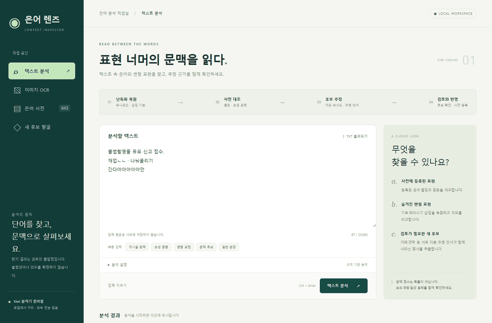
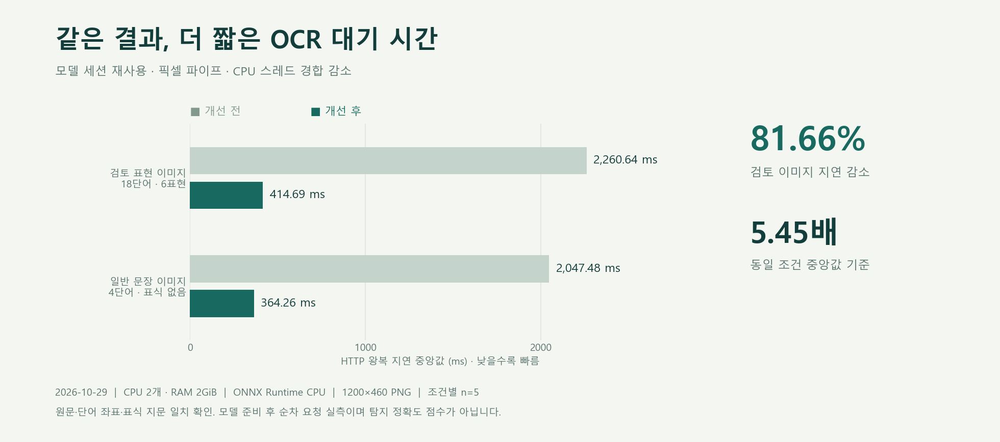
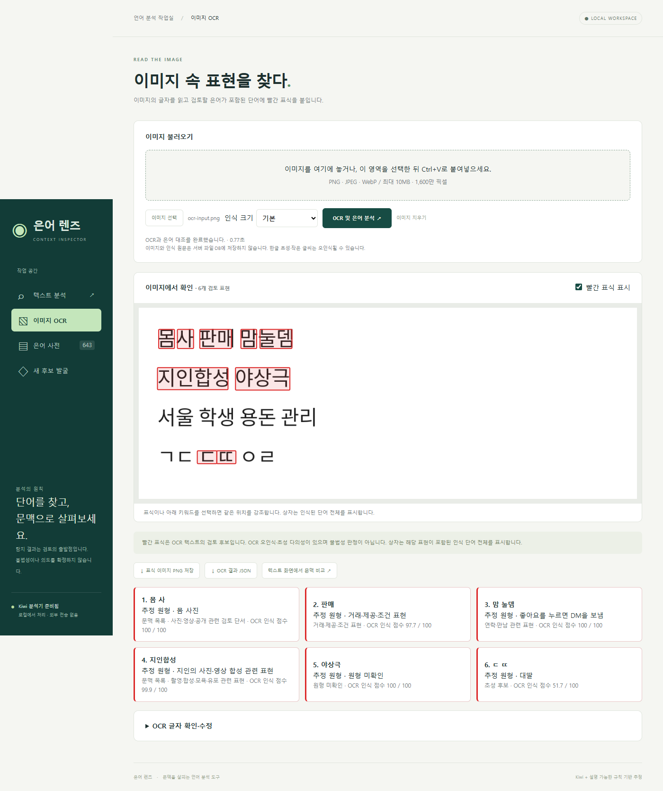

# 은어 렌즈 · Slang Inspector

**한국어 변형 표현을 원문 위치와 근거로 연결하는 로컬 텍스트·이미지 검토 도구**

초성, 삽입 기호, 반복 글자로 변형된 표현을 찾아 원형 후보와 문맥을 함께 보여줍니다. 이미지의 글자는 한국어 OCR로 읽고 해당 단어에 빨간 표식을 표시합니다. 디지털 성범죄 예방·모니터링 업무에서 사람이 검토할 위치를 좁히도록 설계했습니다.



*실행 중인 Web UI를 촬영한 화면입니다. 개인정보가 없는 제작 이미지와 문장을 사용했으며, GIF의 장면 간격은 설명을 위해 편집했습니다.*



| 측정 항목 | 개선 전 | 개선 후 | 결과 |
|---|---:|---:|---:|
| OCR HTTP 지연 중앙값 · 18단어 이미지 | 2,260.64 ms | **414.69 ms** | **81.66% 감소 · 5.45배** |
| OCR HTTP 지연 중앙값 · 일반 문장 이미지 | 2,047.48 ms | **364.26 ms** | **82.21% 감소 · 5.62배** |

측정일 2026-10-29, CPU 2개·메모리 2GiB 제한, 같은 1200×460 PNG를 조건별 5회 순차 요청했습니다. ONNX Runtime CPU 추론이며, 서버 시작 후 모델 준비를 마친 상태의 HTTP 왕복 시간입니다. 변경 전후 인식 문자열·단어 좌표·표식 지문이 일치했습니다. **지연 개선 측정이며 탐지 정확도 점수가 아닙니다.** 2026-10-31 별도 재측정 중앙값은 각각 650.39ms·529.63ms였습니다. [원시 측정값과 재현 절차](docs/performance.md)를 제공합니다.

[실행](#빠른-시작) · [사용법](docs/usage.md) · [구조와 설계](docs/architecture.md) · [성능](docs/performance.md) · [개발·검증](docs/development.md) · [데이터 출처](DATASET.md)

## 주요 기능

| 기능 | 처리 방식 |
|---|---|
| 변형 표현 복원 | Unicode 정규화, 삽입 기호·띄어쓰기 대조, 사전에 대응하는 늘임 복원 |
| 초성 원형 비교 | 사전·참고 자료의 초성 인덱스, 붙은/띄어진 초성, 다의어 후보 병기 |
| 근거를 보존하는 결과 | 원문 구간, 추정 원형, 출처, 주변 단서, 검토 필요 여부를 함께 반환 |
| 한국어 이미지 OCR | PP-OCRv5 한국어 인식 → 텍스트 분석 → 원래 단어 상자에 빨간 표식 |
| 수정과 내보내기 | OCR 글자 수정 후 같은 좌표로 재분석, 표식 PNG·분석 JSON 저장 |
| 사전·문맥 목록 관리 | 기본 사전 643개, 문맥 검토 목록 200개, 등록·삭제 및 문서 묶음의 후보 검토 |
| 선택적 로컬 모델 | 설치된 Ollama 모델로 일상 의미와 은어 후보 비교, 미확인 풀이 유지 |



## 빠른 시작

Windows 11의 PowerShell과 Docker Desktop **Linux 컨테이너** 환경을 기준으로 합니다. 기본 텍스트·OCR 분석에는 GPU나 API 키가 필요하지 않습니다.

```powershell
git clone https://github.com/snmedia153-beep/slang-inspector.git
Set-Location .\slang-inspector
powershell -NoProfile -ExecutionPolicy Bypass -File .\scripts\Start-Slang.ps1
```

기본 접속 주소는 **[http://127.0.0.1:18640](http://127.0.0.1:18640)** 입니다. 시작 스크립트는 다른 컨테이너와 호스트의 포트를 확인해 사용 가능한 포트를 선택하고 `.env`에 저장합니다. 기존 서비스의 포트는 재사용합니다. 실제 주소는 실행 결과를 확인하세요.

첫 빌드에는 Python 패키지와 고정된 OCR 모델을 내려받기 위한 네트워크가 필요합니다. 모델 해시를 검증한 뒤 이미지에 포함하며, 실행 중에는 모델을 자동 다운로드하지 않습니다. Compose는 CPU 2개·메모리 2GiB 상한으로 실행합니다.

```powershell
docker compose ps                    # 실행·준비 상태
docker compose logs --tail 80         # 최근 로그
docker compose stop                  # 데이터 볼륨을 유지하며 중지
```

다른 시작 포트는 `Start-Slang.ps1 -PreferredPort 18650`으로 지정합니다. Linux/macOS에서는 사용 가능한 포트를 `.env`의 `SLANG_PORT`에 지정한 뒤 `docker compose up -d --build --wait --wait-timeout 180`으로 실행할 수 있습니다. [운영과 설정](docs/usage.md#운영과-설정)을 참고하세요.

## API로 연결하기

Web UI와 동일한 분석 결과를 JSON으로 받을 수 있습니다.

```powershell
$payload = @{ text = '불법촬영물 유포 신고'; threshold = 0.82; discover = $true } | ConvertTo-Json
Invoke-RestMethod 'http://127.0.0.1:18640/api/analyze' `
  -Method Post -ContentType 'application/json; charset=utf-8' `
  -Body ([Text.Encoding]::UTF8.GetBytes($payload))
```

| 경로 | 기능 |
|---|---|
| `POST /api/analyze` | 텍스트의 표현·원형·근거·원문 위치 |
| `POST /api/ocr/analyze` | PNG/JPEG/WebP 바이너리 → OCR 단어·검토 표식 |
| `POST /api/ocr/reanalyze` | 수정한 OCR 단어를 원래 좌표에 재대조 |
| `POST /api/context/interpret` | 선택적 로컬 모델의 문맥 비교 |
| `GET /api/lexicon`, `GET /api/watchlist` | 사전·문맥 검토 목록 |
| `GET /api/health`, `GET /api/ocr/info` | 준비 상태·OCR 실행 정보 |

전체 요청·응답 스키마는 실행 후 `/api/docs`와 `/openapi.json`에서 확인합니다. 사전 변경과 후보 발굴 API는 [사용법](docs/usage.md#api)을 참고하세요.

## 설계에서 해결한 문제

- **복원 후에도 위치가 맞는 하이라이트:** 정규화·반복 축약마다 원문 구간을 전달합니다. 분해된 한글과 이모지에도 같은 위치 체계를 사용하고 OCR 단어 좌표까지 연결합니다.
- **작은 CPU 예산에서의 OCR 지연:** 요청마다 모델을 읽는 대신 전용 프로세스와 ONNX 세션을 재사용합니다. 중간 PNG 압축을 없애고 스레드 경합을 줄였습니다. 40초 제한을 넘긴 프로세스는 종료해 다음 요청과 응답이 섞이지 않도록 합니다.
- **초성의 모호함:** 여러 원형을 병기하고 채용·의료·조리 등 일상 단서를 비교합니다. 자료가 없는 초성은 원형 미확인으로 남기며 모델 출력만으로 확정하지 않습니다.
- **관리 가능한 데이터:** 배포 사전의 출처·라이선스·해시를 기록합니다. 사용자가 삭제한 표현은 데이터 갱신 때 자동으로 되살리지 않습니다.

[상세 구조](docs/architecture.md) · [원형 비교와 참고 연구](CONTEXT_RESEARCH.md)

## 기술 구성

| 계층 | 구성 |
|---|---|
| 서버 | Python 3.12 · FastAPI · Uvicorn |
| 한국어 분석 | Kiwi · Unicode/자모 처리 · 사전/문맥 규칙 |
| 이미지 | RapidOCR · PP-OCRv5 Korean · ONNX Runtime CPU · Pillow |
| 저장 | SQLite · Docker named volume |
| 화면 | HTML · CSS · JavaScript · SVG 표식 |
| 선택 기능 | Ollama 로컬 문맥 모델 |
| 검증 | pytest · Ruff · Playwright · 실제 Docker 빌드/실행 |

```text
app/                   분석 엔진 · API · OCR 작업 프로세스 · Web UI
  data/                사전 · 참고 지식 · 문맥 목록 · 출처/모델 매니페스트
scripts/               실행 · 데이터 갱신 · 벤치마크 · 화면 검증/촬영
tests/                 API · 원문 위치 · 문맥 · OCR 회귀 검사
docs/                  사용법 · 구조 · 성능 · 개발 문서 · 실제 화면
reports/               모델 비교 연구의 측정값과 계산 결과
licenses/              배포 데이터의 원본 라이선스
```

## 데이터와 사용 범위

분석 원문·업로드 이미지·모델 응답은 서버 파일이나 DB에 저장하지 않습니다. 사전과 검토 후보의 표현·빈도·단서 정보는 로컬 볼륨에 저장합니다. 기본 공개 주소는 loopback이며 사용자 인증을 제공하지 않으므로, 다른 네트워크에 공개하려면 인증·접근 제어를 추가해야 합니다.

결과는 사람의 검토를 위한 후보입니다. 점수는 확률이나 불법성·동의·실제 연령의 판정이 아닙니다. 일반 성적 표현과 성착취를 동일시하지 않으며, 이미지 자체의 장면을 분류하지 않습니다. 별도의 도메인 정답셋으로 정밀도·재현율을 측정하지 않았습니다.

데이터별 출처와 이용 조건은 [DATASET.md](DATASET.md), [THIRD_PARTY_NOTICES.md](THIRD_PARTY_NOTICES.md), [licenses](licenses/)에 기록합니다. 저장소 전체에 일괄 적용하는 오픈소스 라이선스는 별도로 지정하지 않았습니다.

## 개발과 검증

```powershell
docker compose config --quiet
docker build --target test -t slang-inspector:test .
docker run --rm --network none --cpus 2 --memory 2g slang-inspector:test
```

Python 정적 검사, 실제 브라우저 검증, 성능 재측정, README 미디어 재생성은 [개발 문서](docs/development.md)에 정리했습니다. 이전 변경별 검증 기록은 [개발 이력](docs/history/README.md)에서 확인할 수 있습니다.
