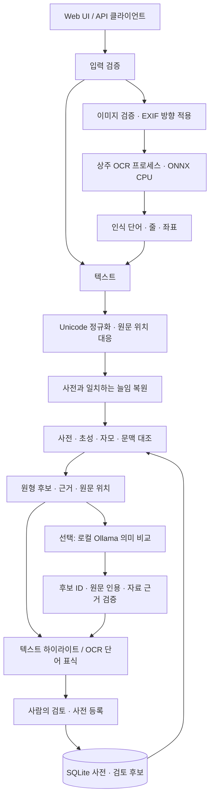

# 구조와 설계

## 분석 경로

## 책임 분리

| 모듈 | 책임 |
|---|---|
| `app/main.py` | 요청 한도·보안 헤더·라우팅·시작/종료 자원 관리 |
| `app/engine.py` | 사전 버전 동기화, 정규화, 규칙·초성·자모 대조, 결과 구간 |
| `app/elongation.py` | 사전으로 제한한 반복/모음 늘임 복원과 원문 구간 전달 |
| `app/initial_candidates.py` | 완성형 한글과 초성의 경계 및 초성 키 |
| `app/post_rules.py`, `app/watchlist.py` | 게시글 구조 단서, 문장 내 조합, 일반 문맥 우선 규칙 |
| `app/contextual.py` | 로컬 모델 호출, 참고 지식, 구조화 응답 검증 |
| `app/ocr.py` | 이미지 형식·한도 검증, 인식 텍스트와 상자의 연결 |
| `app/ocr_process.py` | 작업 프로세스 준비·시간 제한·요청 ID·실패 복구 |
| `app/ocr_worker.py` | ONNX 모델 예열·재사용, 픽셀 입력, 인식 단어 출력 |
| `app/store.py` | SQLite 저장, 배포 사전 해시 검증, 삭제 기록과 후보 빈도 |
| `app/static/` | API 호출, 안전한 DOM 출력, SVG 표식, 파일 내보내기 |

## 원문 위치 보존

`normalize()`는 정규화 문자열과 각 문자의 원문 `[start, end)` 구간을 반환합니다. 분해된 한글은 클러스터로 묶어 조합하고 제로폭 문자를 제거해도 해당 구간을 잃지 않습니다. 늘임 복원도 같은 대응표를 전달합니다. 따라서 줄어든 표현이 검출되어도 원문 전체를 강조할 수 있습니다.

API 위치는 Unicode 코드 포인트 기준입니다. 브라우저는 `Array.from(text)`로 같은 단위를 사용해 이모지 앞뒤에서 UTF-16 오프셋이 어긋나는 것을 막습니다. OCR에서는 줄 경계를 유지한 텍스트를 만들고 탐지 구간과 겹치는 원래 단어 상자를 선택합니다. 단어 내부 글자별 좌표를 추정하지 않습니다.

## 보수적인 원형 비교

사전 항목의 출처·원형·대표 의미는 별도 필드입니다. Kiwi의 `add_user_word(..., orig_word=...)`는 토큰 분석에 사용하고, 원형 출력은 앱의 매핑으로 관리합니다. 같은 초성의 여러 뜻을 병기하며, 자료가 없는 초성은 `unresolved_initials`로 표시합니다. 긴 초성열의 짧은 접두어를 별개 원형으로 해석하지 않습니다.

주변 단서는 같은 문장 안의 제한된 범위에서 결합합니다. 날짜·댓글 수·계정과 일반 단어가 성적 의미로 번지는 것을 억제합니다. 채용·병원·조리 등의 일상 단서와 성적 단서가 충돌하면 단일 풀이를 강제하지 않습니다.

Ollama는 선택 경로입니다. 설치된 로컬 모델만 호출하며 사용자 입력으로 목적지 URL을 지정할 수 없습니다. 모델이 생성한 ID·인용·출처를 확인하고, 원형 미확인 자료의 뜻은 모델이 주장해도 확정하지 않습니다. 모델 연결 실패 시 빠른 분석 결과를 유지합니다.

## OCR 자원 관리

시작 시 OCR 프로세스에서 모델 두 개를 예열합니다. 이후 요청은 회색조 픽셀을 메모리 파이프로 전달하고 같은 세션에서 추론합니다. 중간 PNG 재압축과 요청별 모델 초기화를 제거했습니다. ONNX intra-op 2·inter-op 1, OpenCV 1 스레드와 ONNX 대기 중 회전 비활성화로 CPU 경합을 줄입니다.

OCR 동시 실행은 1개이며 경합 요청에는 429를 반환합니다. 준비·추론을 포함한 작업 제한은 40초입니다. 만료·프로토콜 오류에는 프로세스를 종료하고 다음 요청에서 새로 준비합니다. 요청 ID로 늦거나 잘못된 응답이 다른 이미지에 연결되는 것을 방지합니다.

## 저장과 배포

입력 원문과 이미지는 메모리에서 처리합니다. SQLite에는 사전과 검토 후보의 표현·문서 빈도·단서 정보만 보관합니다. 배포 사전은 매니페스트의 SHA-256을 확인하고 새 버전만 반영합니다. 삭제한 표현의 기록을 남겨 데이터 갱신 시 자동 재등록을 막습니다.

Docker는 비루트 사용자, 읽기 전용 루트, 제한된 `/tmp` tmpfs, capability 제거와 loopback 바인딩을 사용합니다. 서버 종료 시 OCR 프로세스와 Kiwi 참조를 해제합니다. UI는 입력을 `textContent`로 출력하고, 상태 변경 요청에는 동일 출처 조건을 적용합니다. 사용자 인증과 외부 공개를 위한 접근 제어는 배포 환경에서 추가해야 합니다.
